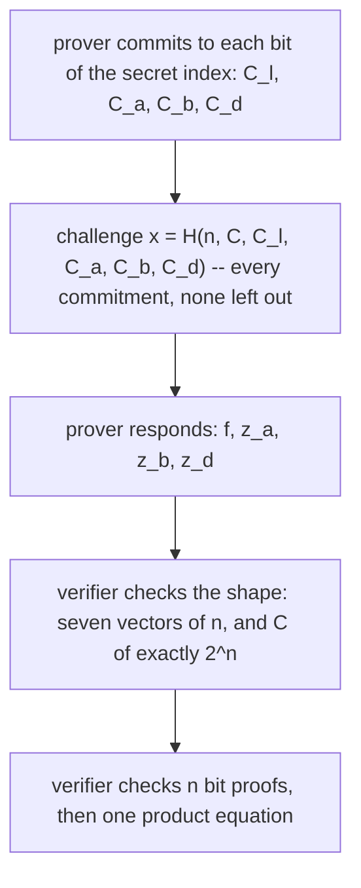

# Crypt

Two halves, written many years apart and sharing only a directory.
`crypt.hh` is a thin RAII wrapper over gpgme — OpenPGP keys, signatures and
encryption, as a mail client needs them. `curve.hh`, `schnorr.hh` and
`groth.hh` are ristretto255 arithmetic and the zero-knowledge proofs built on
it, which is a different kind of code with a different kind of failure: a
wrapper that is wrong usually stops working, and a proof system that is wrong
keeps working and proves nothing.

A map. Every type named here is documented at its declaration, and where the
two disagree the header is right.

- `jlib/crypt/curve.hh` — `Scalar`, `Point`, `BasePoint`, `Commitment`,
  `Hash<N>`: ristretto255, over libsodium
- `jlib/crypt/schnorr.hh` — `Proof`, `MultiProof<N>`: knowledge of a discrete
  log
- `jlib/crypt/groth.hh` — `BinaryProof`, `ZeroProof`: Groth-Kohlweiss
  one-out-of-many
- `jlib/crypt/crypt.hh` — `gpg::data`, `gpg::key`, `gpg::ctx`, and `verified()`
- one library, `libjcrypt`. The ristretto255 half is conditional on libsodium;
  gpgme is not optional

## `sodium_init()`, before anything else

The application's job, once, at the top of `main()`. Not this library's, and
there is no lazy fallback.

It matters more than it looks. `Commitment::G()` and `H()` were once
namespace-scope objects, so they were constructed while the shared library
loaded — before `main()` could possibly have initialised libsodium. On Linux
`crypto_generichash_update` then ran against an uninitialised library and
allocated until the process was OOM-killed, **with no output at all**. They are
function-local statics now, so a `sodium_init()` in `main()` is early enough.

## Uppercase is a point, lowercase is a scalar

Held to throughout, including inside the proofs, because the alternative is
reading an equation to find out which group an identifier lives in. `C`, `C_a`,
`C_d`, `R`, `Y`, `G`, `H` are curve points; `x`, `s`, `f`, `z_a`, `k`, `c` are
scalars.

The two types are not interchangeable and the compiler now enforces that.
Every one-argument constructor is `explicit`, which is worth saying because
three of them read as harmless:

```cpp
explicit Point(const Scalar& scalar);          // a base point multiply
explicit Commitment(const Scalar& value);      // draws a random blinding factor
explicit Scalar(const Hash<HASHSIZE>& hash);   // hash-to-scalar: reduce mod L
explicit Point(const Hash<HASHSIZE>& hash);    // hash-to-curve: from_hash
```

`Scalar::HASHSIZE` and `Point::HASHSIZE` are **both**
`crypto_core_ristretto255_HASHBYTES`, so a single `Hash<64>` satisfies the last
two. Both are correct; they mean entirely different things; and while the
conversions were implicit the one you got was chosen by the destination type.
A hash meant as a scalar, passed to something taking a `Point`, became a curve
point with no diagnostic. `Point::from(const Scalar&)` is the named spelling
where a base multiply is what you want.

## Everything from outside goes through `from_bytes`

There is no writable `data()`. Bytes enter through exactly two functions, and
both validate:

```cpp
Scalar s = Scalar::from_bytes(b);   // throws unless b is canonical below L
Point  P = Point::from_bytes(b);    // throws unless b is canonical below p, and a point
```

Both compare against the constant themselves, with `sodium_compare`, rather
than delegating to libsodium — and that is deliberate rather than
belt-and-braces. Measured across the two versions jlib builds against:

| | bit 255 forced on a valid point encoding |
| --- | --- |
| libsodium 1.0.22 | rejected, 200 of 200 |
| libsodium 1.0.18 | **accepted, 200 of 200** |

1.0.18 masks bit 255 and then checks the low 255 bits, so `x | 2^255` decodes
to the same point as `x`. A ristretto255 encoding is by definition a canonical
field element, so those are not encodings at all. The measurement and why
raising the configure floor is not the fix are in #430.

Two byte strings decoding to one point is malleability, and it is not abstract
here: `Hash::update(const Point&)` hashes the **stored** bytes, and those
bytes go straight into the Fiat-Shamir challenge in both `schnorr` and `groth`.
So the canonicity guarantee has to belong to this library and not to whichever
libsodium the host happens to ship.

Everything else is sound by construction: every other way of making a `Point`
goes through a libsodium operation that yields a valid one. `Point::operator*`
relies on that invariant to read a `-1` from `crypto_scalarmult_ristretto255`
as "the result is the identity" rather than "the input was not a point",
which libsodium reports with the same value.

## Commitments, and why `H` must be hash-to-curve

```cpp
Commitment(value, blind);   // value*G + blind*H
```

A Pedersen commitment, with the homomorphism that the proofs are built on:
`Com(v1,b1) + Com(v2,b2) == Com(v1+v2, b1+b2)`.

Binding rests entirely on **nobody knowing `log_G(H)`**. A party who knows it
can open one commitment to any value at all. So `H` cannot be `h*G` for any
`h` a prover could derive, which rules out the obvious construction of hashing
to a scalar and multiplying:

```cpp
static const Point h(hash<Point::HASHSIZE>(G()));   // from_hash: a real map to the group
```

`crypto_core_ristretto255_from_hash` is a genuine hash-to-curve. The explicit
cast is there to say which of the two possible readings this is, since the
hash would have satisfied `Scalar` just as happily.

## Schnorr: a proof of knowledge is not a signature

```cpp
struct Proof {
    curve::Point  R;   // k*G
    curve::Scalar s;   // k - c*x
};

Proof prove(const Point& G, const Point& Y, const Scalar& x,
            const std::optional<std::string>& message = std::nullopt);
bool  verify(const Proof& proof, const Point& G, const Point& Y,
             const std::optional<std::string>& message = std::nullopt);
```

`verify` takes the public parameters. That is the whole design, and it is worth
stating because the obvious alternative is wrong: a `Proof` that carried its
own `G` and `Y` could only ever be checked against the statement the proof
itself supplied, which is self-consistency and not verification. Such a proof
verifies happily and tells you nothing about the key you care about.

With no `message` these are proofs of knowledge, **not signatures** — they
attest that someone knows `x`, not that anyone assented to anything. Pass a
message and it goes into the challenge, and then it is a signature over that
message. An empty message is a message, and distinct from no message: the
challenge carries a presence byte and a length, because hashing zero bytes is
the same as hashing nothing, and without the byte a bare proof of knowledge
verified as a signature on `""`.

`MultiProof<N>` is the same scheme over `N` generators, for `Y == sum(x[i]*G[i])`.
`generators<N>()` is the default chain — base point, then each generator the
hash-to-curve of the one before — built once as a function-local static.

## Groth: one out of many

Jens Groth and Markulf Kohlweiss, *One-out-of-Many Proofs: Or How to Leak a
Secret and Spend a Coin*, EUROCRYPT 2015. `BinaryProof` is Fig. 1 (§2.3) and
`ZeroProof` is Fig. 2 (§3), and the code is written so that it reads as those
figures do — each equation cited at the site that implements it, so a reader
can check it against the paper rather than against its author. Two differences
in notation, noted at the top of `groth.hh`: the paper is multiplicative where
`curve::Point` is additive, and the paper indexes `j` from 1 and `k` from 0
where the code runs both from 0, so **the code's `j` is the paper's `k`**.

Checked against the paper, equation by equation: `f_j = l_j x + a_j`,
`z_a = r_j x + s_j`, `z_b = r_j(x - f_j) + t_j`,
`z_d = r x^n - sum rho_k x^k`, the two bit equations, and the product
equation all match. So does the padding, which is the paper's own step, and
so does the acceptance condition that is **not** an equation: *"Accept if and
only if `c_l1, …, c_dn−1 ∈ C_ck`, `f_1, …, z_d ∈ Z_q`"* — every group element
really a group element and every scalar really a scalar, before any equation
is evaluated. That is `index_bits()` for the vector lengths and `from_bytes`
for the elements.

`ZeroProof` shows that **one of** a list of commitments opens to zero, without
saying which. The secret index is proven a bit at a time, which is where the
shape comes from:



Eight vectors, seven of them length `n` and one of length exactly `2^n`. Those
lengths are **part of the proof**, which means they arrive from whoever is
trying to convince us and are exactly as untrusted as the contents.
`verify` establishes the shape before indexing anything, and returns `false`
for a malformed proof as readily as for a false one — a verifier has nothing
to say about the difference, and distinguishing them would hand the prover a
way to pick which failure the caller sees.

`prove` pads the list up to `2^n` by repeating the last commitment, so the
proof's own `C` may be longer than the one handed in. The padding is public
and the real index is never among it. `ceil(log2(size))` is computed with
integer arithmetic, because `std::log2` of a large power of two can land a hair
either side of the integer and `std::ceil` then gives two different answers —
here, two different proof sizes.

## The challenge is written once

Both schemes are non-interactive by Fiat-Shamir, and in both the challenge
function is written exactly once and shared by `prove` and `verify`.

That is not tidiness. A `prove` and a `verify` that hash different things is
the one bug neither scheme survives, and duplication is the easiest way to
introduce it — #425 is how that happened here, and why no test could catch it. It is also why **every** first-round commitment is in the hash,
including the ones it is tempting to leave out: a commitment outside the
challenge is one the prover can still choose *after* seeing the challenge, and
the verifying equations are linear in it, so a prover who can pick it
afterwards can solve for one that passes the check while committing to
something it should not.

## The gpg half: `op_verify` is evidence, not a verdict

`gpg::data`, `gpg::key` and `gpg::ctx` are RAII handles over gpgme's. The one
thing to understand before using any of it:

```cpp
gpgme_verify_result_t r = ctx.op_verify_detached(sig, signed_text);
if(gpg::verified(r)) { /* ... */ }
```

`gpgme_op_verify` returns an error only for **operational** failure — a
malformed packet, a missing engine. A signature that is simply bad is a
*successful* verify operation carrying a bad signature in its result, so
`op_verify` returning without throwing says nothing whatever about validity.
`verified()` is the verdict: it walks `signatures[]` and requires each to be
good, and an empty list is false, because no signature is not a good signature.

The two forms are separate functions because the meaning of the second
argument changes completely between them — `op_verify` is inline and writes
the recovered message, `op_verify_detached` takes the text the signature is
over. Hand a detached signature to the inline form and you get the trap in its
purest shape: the operation succeeds, and on gpgme 2.1.2 the result carries no
signatures at all.

Encryption does **not** always trust:

```cpp
void op_encrypt(const key::list& rcpts, data::ptr plain, data::ptr cipher,
                trust t = trust::required);
```

`GPGME_ENCRYPT_ALWAYS_TRUST` bypasses the web of trust, which means encrypting
to whatever key was handed over — a substituted key becomes indistinguishable
from the right one. It is a parameter, and it defaults to off.

## What it is not

- **Not a protocol.** There is no wire format, no serialisation, no versioning.
  `from_bytes` and `data()` are the boundary, and what you do with 32 bytes
  either side of it is yours.
- **Not constant-time end to end.** What is: `Scalar` and `Point` comparison
  (`sodium_memcmp`), scalar and point arithmetic (libsodium's), and `~Scalar()`
  scrubs with `sodium_memzero`. What is not: anything built on top that
  branches on a secret, and the exponent in `operator^`, which loops `|k|`
  times. The library does not claim more than that, and timing it from a unit
  test would measure the host rather than the code.
- **No high-level `sign`/`encrypt`/`decrypt`.** Seven such functions existed
  and every one was `return "";`. They are gone rather than finished: in this
  file that is the worse failure, because a caller asking "is this signature
  good" got an empty string. Use `ctx` directly.
- **No key generation, export or import through the wrapper.** `ctx::gpgme()`
  is the escape hatch, and that is what `crypt_gpg_test` uses.
- **No example driver.** `jlib/apps/jcurve` is in `bin_PROGRAMS` and is a stub:
  a licence header, `sodium_init()` and an empty `try` block. Said here because
  a reader who finds it in the binary list should not have to open it to learn
  that. The four test programs under `tests/` are the working examples, and
  `crypt_groth_test` is the one that exercises the most. #424 is the plan for
  making jcurve real, and the interesting part of it is not the flag list: a
  command-line tool has to have a wire format, which this library deliberately
  does not.
- **Zero-knowledge is argued, not tested.** It is a property of a simulator,
  not of any run. What the tests do pin is that the nonce commitment differs
  between two proofs of one statement, which is the part whose failure would
  leak the secret outright.
- **Not a signature, in the groth half.** The paper's own Fiat-Shamir
  instantiation of Fig. 2 is a *ring signature*, Fig. 3, whose challenge is
  `x = H(ck, M, R, a)` — commitment key, signed message, statement, initial
  message. `groth::challenge` follows that term for term except `M`, which is
  deliberately absent because a one-out-of-many proof is not usually used to
  sign. So a `ZeroProof` attests that the prover knew an opening and nothing
  more: it carries no assent, and it is replayable by anyone holding a copy.
  `schnorr` takes an optional message for exactly this reason; groth does not.
- **`(n+1)`-special sound, not 2-special sound.** Fig. 2's soundness argument
  rewinds `n+1` accepting responses, so the forking argument behind the
  non-interactive version is heavier than its three-move shape suggests.
- **Not audited.** Reviewed closely and tested hard — 110 assertions across
  four test programs, and the ristretto255 three run clean under
  `-fsanitize=address,undefined` — which is not the same thing and should not
  be mistaken for it.

## Where this is load-bearing

- **`jlib/apps/jcrypt.cc`** — the only caller of the gpg half in the tree, and
  it reads `can_sign` and `can_encrypt` through `key::gpgme()`.
- **`jlib/math/polynomial.hh`** — `Polynomial<curve::Scalar, Scalar::Power>` in
  `groth.cc` is the only non-test user of that header's `Power` policy, and the
  reason it exists: in a curve's field, `std::pow` is not merely inaccurate but
  meaningless.

The ristretto255 half is 1,428 lines of header and source against 696 lines of
test. For code whose failures are silent, that ratio is the point.
