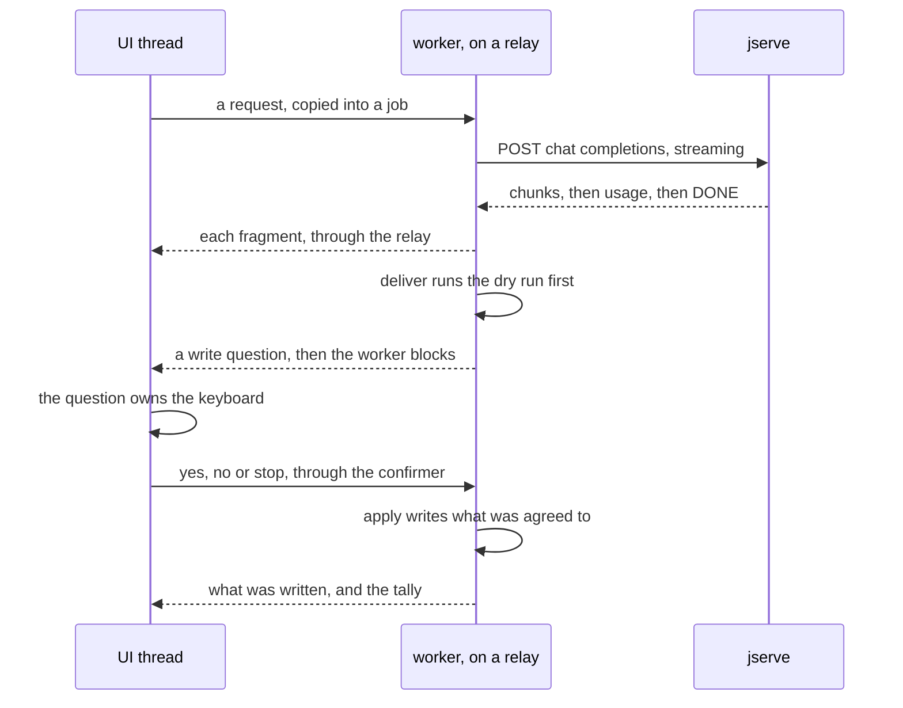

# juanaco

jcode with a transcript that stays put: a single pane, the task summarised at the top, a prompt pinned below, and the reply — with its tool calls, its build output and its edits — arriving into the transcript between them.

It was built in six phases under #444 (#445–#450). This document was written first, as the design the arc was filed from, and revised once the program existed; the places where the two disagreed are recorded below rather than smoothed over, because they are the useful part. Every type named here is documented at its declaration, and where this and a header disagree, the header is right.

- `jlib/apps/juanaco.cc` — the program
- `jlib/apps/jcode.hh` — the library underneath, and the write policy both front ends share
- `docs/jcode.md` — the same loop, written to a stream
- `docs/jalpaca.md` — the same relationship, one layer down
- `docs/jserve.md` — what it talks to

## Why it is a second program and not a flag on jcode

Because jcode is the tested one. `app_jcode_test` covers the pieces and `app_jcode_run_test` drives the whole program against a scripted endpoint and asserts what lands on disk — both down a pipe, and **a curses program cannot be driven down a pipe** usefully: measured for #445, down a pipe `initscr()` succeeds, reports terminfo's default 24 by 80 rather than a real size, and `getch()` returns ERR, so it starts and cannot be typed at.

So #445 built a pty harness before any of this existed, and juanaco has been driven by `make check` from its first phase. This is jalpaca's argument, unchanged: the loop is deliberately the same loop over the same pieces, and what differs is where the characters go.

## What it reuses, which is almost everything

`jcode.hh` is a library rather than a monolith, and its injection points are exactly what a terminal interface needs. They exist so the loop can be tested with no model, no server and no disk; that is what makes them reusable for presentation.

| seam | juanaco supplies |
| --- | --- |
| `exchange` | SSE against jserve, each delta pushed to the transcript as it arrives |
| `builder` | the build's output, first twelve lines, into the transcript |
| `writer` | `jcode::deliver`, with a dialog for its voice |

`converse()`, `until_built()`, `lay_out()`, `parse()` and `apply()` are untouched and stay covered by jcode's tests.

### The writer is shared, not copied — and this is where the design moved

The design said juanaco would *reproduce jcode_main's control flow exactly and change only the presentation*, on the grounds that **the interface is a skin, not a second policy**: if it decided for itself which edits were worth asking about, the two could drift in what they write to a disk, and only one of them is covered by `app_jcode_run_test`.

That reason argues for sharing rather than copying, and the build proved it. #447 took a copy of jcode_main's writer, and **by #449 the copy had already drifted** — it named an unnamed refusal differently and had no dry-run branch. Nobody chose either difference. So the policy is one function now, `jcode::deliver()`, and both programs call it; they inject only a `teller` (one line of what is happening) and an `asker` (one edit known to apply).

## Streaming without changing a tested typedef

`exchange` returns a *complete* `ai::openai::answer`, which reads like a prohibition on token-by-token rendering. It is not one. juanaco's implementation reads the SSE chunks as they arrive, parses each with `ai::openai::delta::parse()`, pushes every fragment to the transcript as a side effect, and returns the assembled answer. The signature never changes, so nothing jcode's tests cover moves.

A reply accumulates into **one** transcript entry rather than one per fragment, because the transcript is re-wrapped from text on every draw — sixty entries of four characters wrap to sixty rows.

**Token counts on a stream need asking for.** The protocol puts no usage block in a chunk, so for five phases the streaming path — the default — could not say what a reply cost or how full the context was. #450 asks with `stream_options.include_usage`, which makes the server send one last chunk with an *empty* `choices` array and a `usage` object; jserve sends it only to a client that asked, because a client that did not may not survive that shape — `delta::parse` itself refused it until it learned to read it.

## The layout, as built

    top line, inverted   the task, then the model and the edit format
    transcript           your prompts, the reply, tool calls, build output, edits, notes
    prompt               multi-line; replaced by the write question while one is up
    status line          tokens in / out, ctx used/ceiling, rounds, attempts, state and clock

Each transcript entry carries a tag rather than a colour: `>` for what you typed, nothing for the model, `::` for a tool call, `|` for build output, `**` for an edit, `--` for juanaco talking about itself. Colour was lost when the pad went (below), and the tags carry the distinction instead.

**The transcript is a list of typed entries rendered on demand**, as designed — and that turned out to be load-bearing for a reason the design did not foresee. The first version drew it into a curses pad, blitted with `prefresh`; the `refresh()` that followed pushed `stdscr` over the top, whose copy of those rows was blank, so the transcript was painted and wiped on every draw and **nothing but the header, the prompt and the status line was ever visible**. Keeping the text is what made the fix simple rather than a refresh-ordering puzzle: the visible slice goes straight into the one window everything else is in.

The status line's last word says what is true, not what is likely:

| word | means |
| --- | --- |
| `idle` | nothing in flight |
| `waiting 12s` | sent, and nothing back yet |
| `streaming 14s` | tokens arriving |
| `asking 3s` | the worker is blocked on a write question — on you |
| `cancelling 1s` | Escape was pressed and the work has not stopped yet |

**`waiting`, not `prefill`.** From the client's side a server that is prefilling and one that has died are the same thing, and the table at the end says how long that silence lasts. **`asking`, not `streaming`**, came from a live run that showed `streaming 7s` beside a dialog — busy, when it was in fact waiting for the person reading it.

## Where the work runs

The harness blocks: `exchange` makes a synchronous HTTP request, `builder` runs a compiler, `apply` touches disk. So `until_built()` runs on a `sys::relay` thread — jlib's established answer for a long external action, and what jserve already does for generation — reporting back through a pipe while the curses loop reads keys with a 50 ms `timeout()` and drains events between them. `net::http` being synchronous is right here rather than a limitation: the async machinery exists for things that are not a single connection in their own thread, and this is one.

The model list is fetched on **a second relay**, at startup and on `/model`. It started on the request's, which meant a prompt typed while the list was in flight was refused with "still working" for a question nobody had asked.

### The one exchange that runs backwards

Every event flows worker to UI except one: a write question. The worker asks, **blocks**, and is answered by a keystroke only the UI thread can collect. That is `confirmer` — a mutex, a condition variable and one slot, not a second relay, because a relay is a descriptor and a queue and this carries a single value that is only ever outstanding once.

The design named three ways this hangs a program, and each has an answer and a pty test:

- **Escape at the dialog** is `abandon()` — stop, to this question and every later one, without waiting. Stop is not no: no leaves this file and goes on asking; stop leaves every remaining file unasked, *and ends the attempt*, so an edit agreed to before the Escape is not built and sent round again.
- **A resize mid-dialog** is handled by where the question lives: in the state `draw()` repaints from, so `KEY_RESIZE` redraws it with everything else.
- **Leaving while the worker is blocked** abandons first. Otherwise the worker would sit out the exit's two-second grace and be `_Exit`ed past — the wrong way to leave something that was only waiting for an answer.

Two more hazards were found by thinking about the keyboard rather than in the design. While a question is up **it owns the keyboard**: a `y` meant for it must not land in the prompt, and whatever was being typed is kept and comes back intact. And **a double tap must not answer a question nobody saw**: both bytes of `yy` arrive in one read and the next question appears microseconds later, so `flushinp()` discards typeahead after every answer and when a question appears.

## Escape

It stops a reply. Returning false from the body sink abandons the response and closes the socket, and a closed socket is what jserve notices — in `peer_gone()` between tokens and, since #402, during prefill — so Escape frees the server's model rather than merely stopping the rendering. What had arrived stays in the transcript.

**What the design said next was wrong.** It said Escape stops a reply *without ending the conversation, because the turns so far are the context for the next prompt*. juanaco has never carried turns between prompts: each one is laid out afresh, from the system prompt, the files as they are on disk now, and the new request. A follow-up reaches the model with no memory of the exchange before it. That is #461, and the design question in it is real — replaying earlier turns means replaying them against files the edits have since changed.

**And it cannot land instantly during prefill.** The sink is where cancellation is noticed, and the sink is not called until something arrives — so an Escape in the silent stretch is recorded, the status line says `cancelling`, a note says it takes effect at the first token, and it does. #451's prefill chunk would close the gap, and is the same addition that would give the clock something real to show.

## Keys and commands

| key | what it does |
| --- | --- |
| Enter | sends — or, while a request is in flight, is refused and the line kept |
| Ctrl-J | a newline in the prompt rather than a send |
| Ctrl-U | clears the prompt |
| Escape | stops a reply; at a write question, stops asking |
| `y` / `n` | at a write question |
| Ctrl-C, Ctrl-D on an empty prompt, `/quit` | leaves |

**Ctrl-U is load-bearing, not a convenience.** A line refused because a request is in flight stays in the prompt, which is the kind thing to do with a paragraph — and without a way to clear it, `/quit` typed next became `and so is this/quit`, which is not a command, so it was refused in turn and Ctrl-C was the only way out.

A prompt that starts with a slash is written `//like-this`, IRC's convention, because a coding harness meets a leading slash the first time someone pastes an absolute path.

| command | what it answers |
| --- | --- |
| `/model` | what the server lists, each with its context, the one in use marked; `/model NAME` chooses, and a name the server does not list is refused on the spot |
| `/stats` | tokens in and out across the session, **context used against the model's ceiling**, the layout budget, and the last request's rounds, attempts and seconds |
| `/files` | what the last request put in front of the model, what `lay_out()` left out and why, against which budget |
| `/mode` | edit format (`whole` or `hunks`), build on or off, rounds, attempts |
| `/help`, `/quit` | |

`/files` answers the question you most want answered when a model edits the wrong thing: what did it actually see? `lay_out()` always decided that and recorded why; nothing showed it after its one transcript line scrolled away.

`/stats` answers two questions rather than one. #437 measured a conversation's key-value cache at 1.53x the model's file size by 2048 tokens, and on a 16 GB machine with a 4.4 GB coder model that is a limit reached in ordinary use — and the symptom is paging rather than an error, because **a load that does not fit succeeds**. The second question is speed: decode falls from 20.1 to 9.6 tok/s between 256 and 4096 tokens of context, so the same number explains why a long session feels slower than a fresh one.

**The ceiling comes from the server now.** The OpenAI model list carries names and nothing a client could size a request by, so jcode's `--context` was always *told, not asked*. #450 adds `context_length` to jserve's `/v1/models` — the GGUF's own key, read with the same function a load uses, so the ceiling reported is the ceiling enforced. A client that does not know the field ignores it. jserve reads it for every model at startup, about 10 ms a file, so the list never touches a disk. With several models offered and none chosen, juanaco shows `?` rather than guess which one the server will pick.

Three bugs in these commands were found while making them real, and each was invisible from the outside. **`/model NAME` had never switched anything**: it set the field the top line drew from, and every request was built from `--model`. **`/stats`' token totals reset at every prompt**: the worker sent a running total and the UI assigned it. And the doc and a message both promised a conversation that did not exist (above).

## How it is tested

Through the pty harness from #445 and a scripted OpenAI endpoint (`tests/scripted.hh`), with no model, no GGUF and no network: `app_juanaco_test`, 136 assertions at #450. What it asserts on is the **screen**, reconstructed from the byte stream by a minimal terminal model (`tests/vt.hh`), not the stream itself — the pad bug above passed a stream-matching test, because every answer was in the stream and none of it was on screen.

Every guard was broken and watched to fail. The findings that cost the most were in the test harness rather than the program, and are the reason the rules below exist:

- **A scripted endpoint has to answer the question it was asked.** It ignored the request's `stream` flag, answered a stream request with a whole reply, and the client rendered nothing; then it sent a stream with a `Content-Length`, which a reader may buffer whole, so the delays were invisible. It reads `stream` and `include_usage` from the request, sends chunked SSE as jserve does, and answers `GET /v1/models` now.
- **`settle()` must wait.** It called one `select`, and a pty master hands back as little as one byte per read, so a 30-second poll spun through 300 iterations in 0.1 s. It failed six runs of six and passed the moment a `printf` was added — the printf being the only delay in the loop.
- **The screen model has to model what curses actually sends.** ncurses shortens a line in the middle with a delete-character sequence when that is cheaper than rewriting it, and `vt.hh` discarded it — so `... streaming 0s` turning into `... asking 0s` was reconstructed as `askeaming 0s`, which no terminal ever showed. It surfaced only when a sabotage changed the line's length, which means any assertion on a line whose length changes could have been failing, or passing, for the wrong reason. `vt.hh` handles `DCH`, `ICH` and `ECH` now.
- **An assertion that cannot fail is not one.** Two were caught before they ran: a request count compared against zero, true of any run at all, and an "Escape ends the attempt" check that could not fail without a build that made a second attempt the thing that would happen next.

The default edit format is `whole`, measured rather than assumed: against a real model the `hunks` default failed a one-line edit, because jcode's filename leniency is whole-only (#457).

## What a working juanaco does not establish

**That the prefill wait is reported**, and it is the dominant fact about how this feels. Measured on `Qwen2.5-Coder-7B-Instruct-Q4_K_M` over Metal, machine quiet and swap empty throughout:

| prompt | time to first token | decode after it |
| --- | --- | --- |
| 256 | 1.14 s | 20.1 tok/s |
| 1024 | 3.66 s | 16.7 tok/s |
| 2048 | 12.30 s | 13.4 tok/s |
| 4096 | 30.13 s | 9.6 tok/s |

Prefill is superlinear — doubling the prompt roughly triples the wait — and at 4096 tokens, an ordinary context for a harness that sends whole files, it is **about 93% of the total**: thirty seconds of silence, then a 2.4 second reply. Nothing is on the wire for any of it, so the interface has elapsed time and nothing else.

- **Decode needs no attention at all.** At 9.6 to 20 tok/s, rendering a token at a time is free.
- **An elapsed counter is the floor, not the answer.** Thirty seconds of a ticking number still reads as hung. #451 is the real fix and it belongs to jserve: the prefill loop already calls a predicate every 256 tokens, added in #402 so a departed client could be noticed, and a loop that asks "does anyone still want this?" can answer "and this is chunk 12 of 16" for nothing.

There is no progress bar, deliberately. Prefill is superlinear and machine-dependent, so a client-side estimate would be fabricated, and a fabricated bar is worse than a counter that is merely unhelpful.

**That a follow-up remembers.** Each prompt is a fresh conversation (#461).

**That any endpoint but jserve works.** v1 points at jserve only. An arbitrary OpenAI-compatible endpoint brings key handling and rate limits, and `context_length` and the usage chunk's shape are jserve's to promise; `--url` exists, so this is a scope decision rather than a missing mechanism.

**That a session survives the process.** There is no persistence in v1. Persistence is the first thing that turns into a file format.

**That two models can be resident at once.** jserve lists every model it was given, and #278's admission half is unbuilt, so choosing a second one is answered by whatever a failed allocation looks like — on this machine, a load that succeeds and pages. juanaco's part is to say so rather than appear to hang: a refused request is a transcript line with the server's reason, and a slow one is a clock that keeps counting.

## Deliberately absent

No mouse, no split panes, no syntax highlighting, no diff viewer beyond plain hunks, no MCP, no sub-agents. Each is where a terminal interface stops being a program and becomes a project.
